# The club website manual

For Prospector Soccer Club volunteers who edit the website, and for the people who manage their accounts.

You can update the website without touching code. Almost everything follows the same four steps: **edit a draft, preview it, ask for a review if you want one, publish.** Saving a draft never changes the public site. Only publishing does.

The site is currently labelled a redesign concept. The merchandise area is a demonstration and accepts no orders. Registration still happens through TeamSnap, so keep registration links pointing there.

## Contents

- [Sign in and passwords](#sign-in-and-passwords)
- [The dashboard](#the-dashboard)
- [Editing basics](#editing-basics)
- [What lives where](#what-lives-where)
- [Media library](#media-library)
- [Preview, publish and schedule](#preview-publish-and-schedule)
- [Reviews](#reviews)
- [History and undo](#history-and-undo)
- [Audit log](#audit-log)
- [People and roles](#people-and-roles)
- [Search and keyboard shortcuts](#search-and-keyboard-shortcuts)
- [Merchandise concept](#merchandise-concept)
- [Troubleshooting](#troubleshooting)
- [For the maintainer: recapturing the pictures](#for-the-maintainer-recapturing-the-pictures)

The pictures in this manual were taken on a practice copy of the site with the starter content, signed in as an Owner. Your screens will show your club's content, and some buttons appear only for certain roles.

## Sign in and passwords

1. Open the club website and use the **Admin** link in the thin bar at the top, or add `/admin` to the site address.
2. Enter your username and password and choose **Sign in**. Everyone has their own account; there is no shared club login.
3. If you were given a temporary password, the site opens **Profile** and will not let you go anywhere else until you change it. Enter the temporary password as **Current password**, type a new password twice, and choose **Update password**.

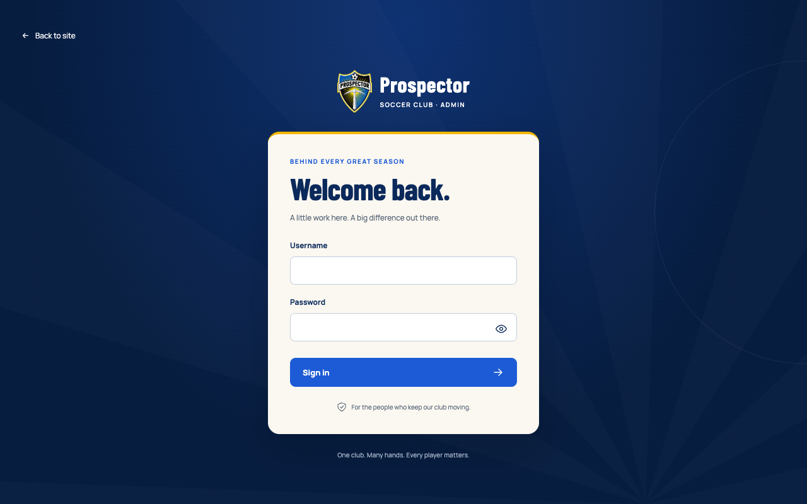

Password rules: at least 10 characters, not your username, not a common password, and different from your current one. A long phrase you can remember is a good choice. Store it in a password manager.

You can change your password any time in **Profile**. Changing it signs out your other devices. Profile also lists **Active sessions**, with a button to sign out the others. If your account was one of the original setup accounts, Profile may show an optional reminder to strengthen the password; you can dismiss it.

Forgot your password? There is no email reset. Ask an Admin or Owner to reset it for you; they will give you a new temporary password. After five wrong attempts, sign-in is locked for 15 minutes (longer if it keeps happening). Wait for the time shown rather than retrying.

You stay signed in for two weeks of inactivity. On a shared computer, use **Sign out** when you finish.

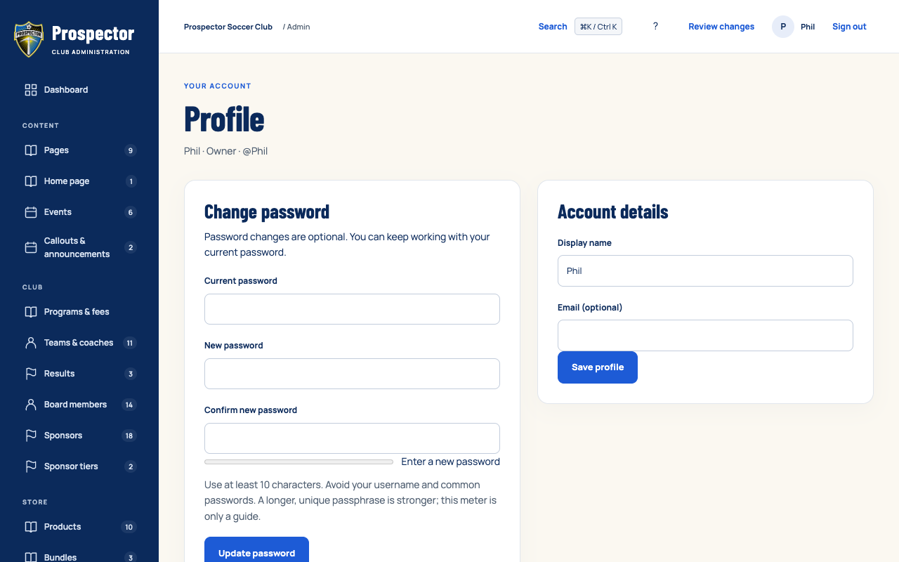

## The dashboard

The dashboard is the home screen after sign-in.

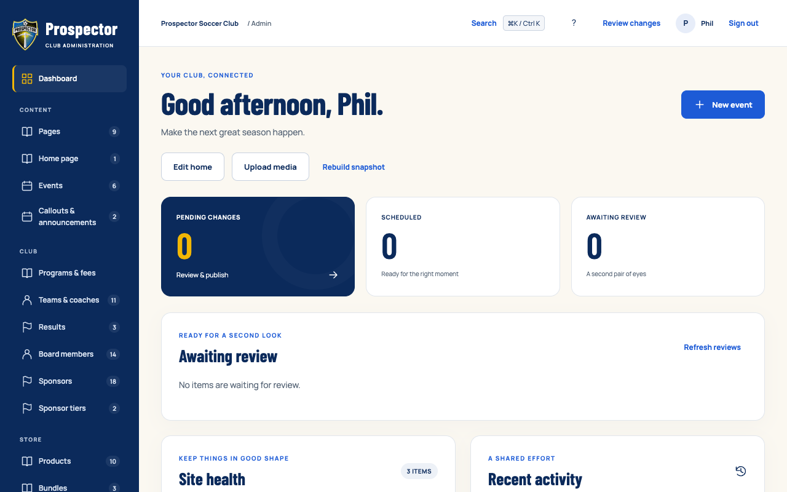

- **Pending changes** counts saved drafts that are not yet published, including other people's. Choose it to open **Review & publish**.
- **Scheduled** counts items waiting for a release time.
- **Awaiting review** lists drafts that someone has asked a publisher to check (shown to Editors, Admins and Owners).
- **Site health** flags things worth fixing, such as images without alternative text, past events still showing, or broken links. **Review item** opens the content.
- **Recent activity** shows the latest actions (details for Admins and Owners).
- **New event**, **Edit home** and **Upload media** are shortcuts. **Rebuild snapshot** (Admins and Owners) regenerates the public site from what is already published; it is a repair tool, not an undo.

On a phone, the bottom bar gives you Dashboard, Events, Content (the full menu) and Media.

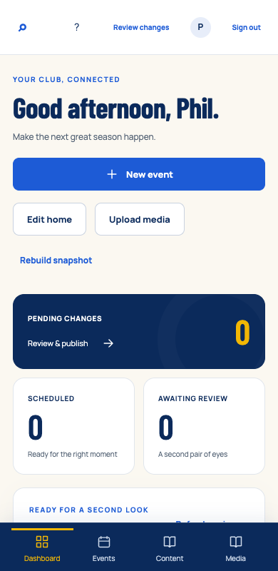

## Editing basics

### Lists and forms

Open a section from the left menu, such as **Events**. Search or filter, then choose an item to open it. To add one, choose **New event** (or the matching New button), fill in the fields marked with an asterisk, and choose **Create event**. After that, changes save automatically a moment after you stop typing or leave a field. Wait for **Saved** next to the title before you close the browser.

**Save checkpoint** marks a named point in the item's History you can return to later. It does not publish.

Repeatable blocks (fee rows, cards, coaches) use **Add item**. Open a row to edit it, duplicate it, or remove it. Where the public order matters, set the list's **Sort by** to **Display order**, clear any filters, then drag the handle or focus it and press Alt + Up/Down. Publish to make the new order live.

Each row's **Actions** menu has preview, history, duplicate and **Move to trash**. Trashing is reversible: a published item stays live until you publish its removal, and switching the list to its **Trash** view shows **Restore**. Content that is still used elsewhere (for example a document linked from a page) cannot be trashed; follow the **Used by** links and remove those references first. Cancel an item's schedule before trashing it.

Tick several rows for bulk actions. Read the result: a bulk action can stop part-way if one item cannot be changed.

### Text formatting and links

Rich-text fields have bold, italic, link and, where allowed, list buttons. Use them rather than pasting from a web page. The small preview under the field shows the formatting; the page **Preview** shows it in the real design.

For a link, give the visible text and the destination: a full `https://` address for another website, a path like `/recreational` for a page on this site, or `mailto:` where email links are allowed. Check registration links against the club's TeamSnap account.

### Editing on the page itself

Open a page and choose **Edit on page**. Editable parts of the page are outlined. Click one to edit it: plain text edits in place (Enter or clicking away keeps it, Escape cancels), and longer text or images open their normal control beside the page. **Back to form** returns to the form. These edits save as drafts like any other.

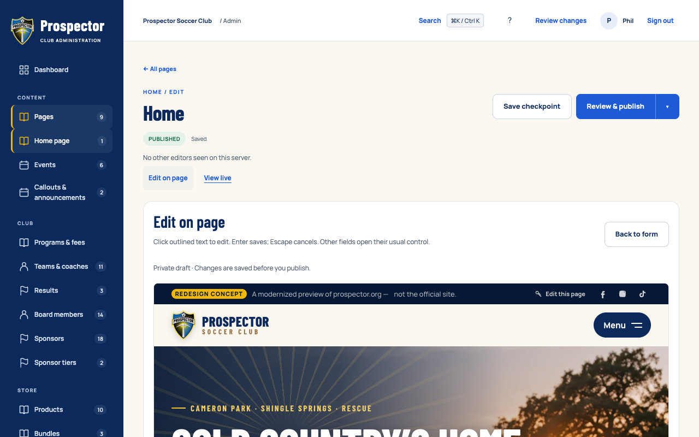

Some parts of the page are shared content (navigation, footer, sponsor logos) or fixed layout and cannot be clicked. Edit those in **Site settings** or the relevant collection.

## What lives where

### Site settings

**Site settings** holds information used across the whole site. Editors, Admins and Owners can change it.

- **Name**, **Short Name**, **Tagline**, **Areas Served**: how the club is described.
- **Contact**, **Socials**, **Links**: shared contact details and external destinations.
- **Utility Bar**: the thin strip at the very top. **Enabled** shows or hides it, **Pill Text** is the highlighted label (currently "Redesign concept"), **Message** and **Message Long** are the short and wide-screen messages. The strip also carries the public **Admin** link, so hiding it means bookmarking `/admin`.
- **Banner**: a separate site-wide announcement with text, optional link and colour style. Off by default.
- **Nav**, **Header call to action**, **Footer**: the menu, the main header button and the footer. Preview several pages after changing these.
- **Search engines → Indexable**: whether search engines may list the site. Leave it off until the website maintainer confirms the site is ready to go public.
- **Events → Hide Past After Days**: how many days a past event stays in public lists (default 60).

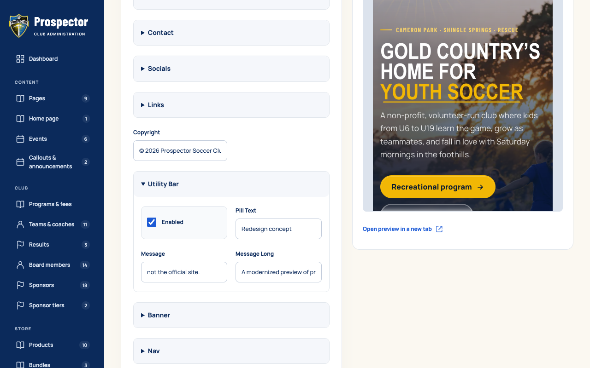

Change a section, preview, then publish Site settings like any other item. One thing Site settings cannot change: the small "Redesign concept · imagery generated with GPT Image" line at the very bottom of every page is built into the design and needs the website maintainer to remove it.

### Pages

**Pages** lists Home, Recreational, Competitive, Referees, Sponsors, Board, Resources, About and the Shop page. Open one and expand the section you want. **Page details** holds the browser title, description and the image used when the page is shared on social media. The other sections hold the hero, body copy, buttons and page-specific lists.

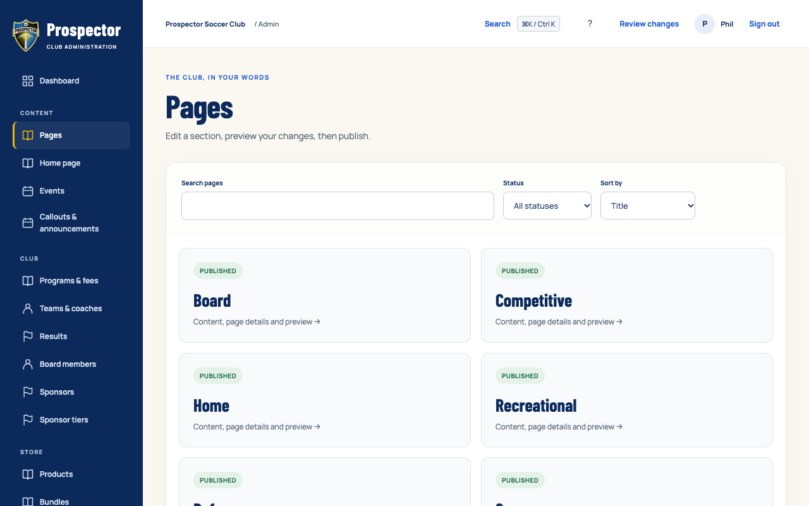
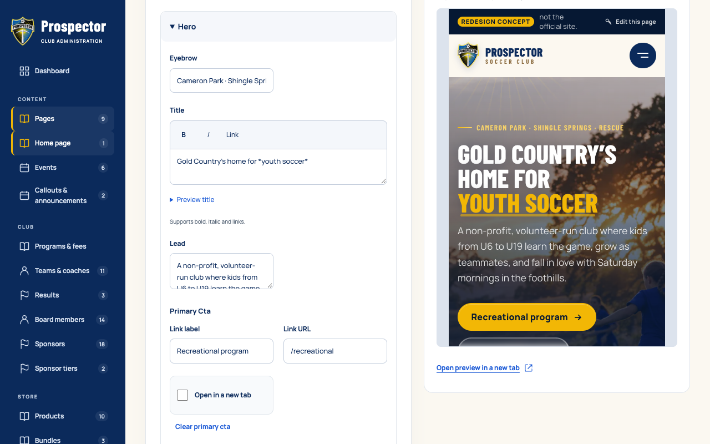

### Events

**Events** feed the home page. Each needs a **Title** and **Date**; add **Type**, **Time**, **End time**, **Location**, **Location details**, a **Calendar title** (used for the add-to-calendar text), a **Link** and **Notes** as needed. **Show on home page** controls whether it appears there. Times are Pacific.

Create or save, preview the home page, publish. When copying an old event, update the date. Past events fade or disappear according to the Site settings age limit.

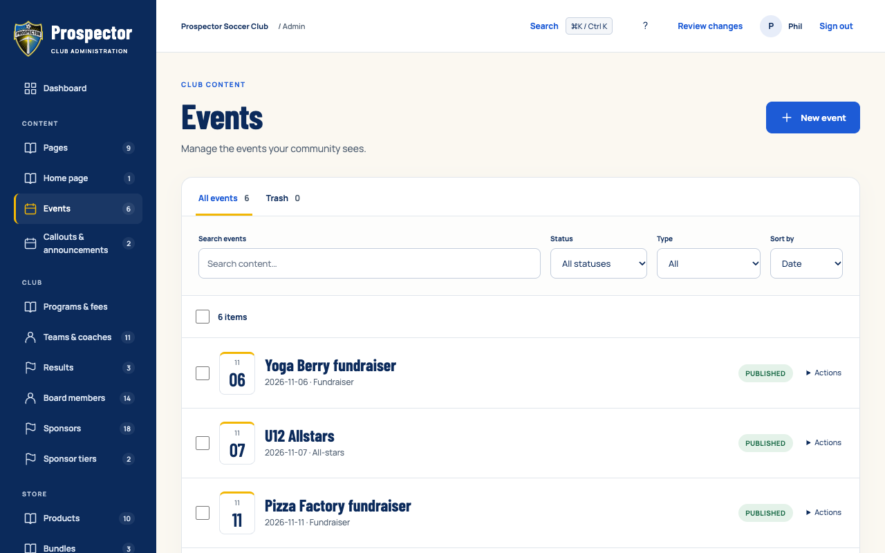
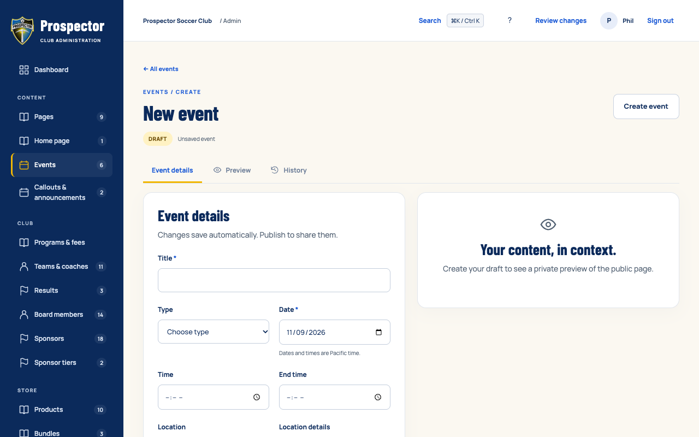

### Callouts and announcements

**Callouts & announcements** are the cards near the top of the home page. Give each a **Title** and **Href** (where it links), and optionally **Pill text** and style, **Text** and an **Icon**. Keep **Active** ticked to show it. **Starts at** and **Ends at** set an optional display window in Pacific time; leave either blank to leave that end open.

A display window controls when a *published* callout is visible. Scheduling *when a draft goes live* is a separate action (see Schedule for later). For a notice on every page, use **Site settings → Banner** instead.

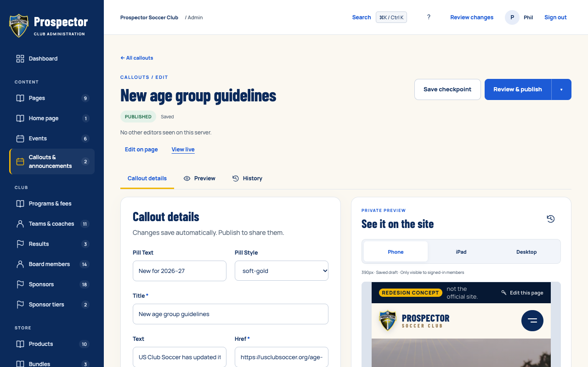

### Programs and fees

**Programs & fees** is a set of shortcuts into the page sections that own this information:

1. **Home programs**: the program summary cards on the home page.
2. **Recreational fees**: age/grade bands with **Amount** (and **Maximum** for a range), registration window, optional late price and notes.
3. **Competitive costs**: cost lines, amounts, estimate notes, documents and the total label.
4. **Coaching program**: competitive-page coaching copy and application links.

When fees change, check the home-page summary and the program page together; the numbers are not linked automatically. Keep registration buttons pointing at TeamSnap.

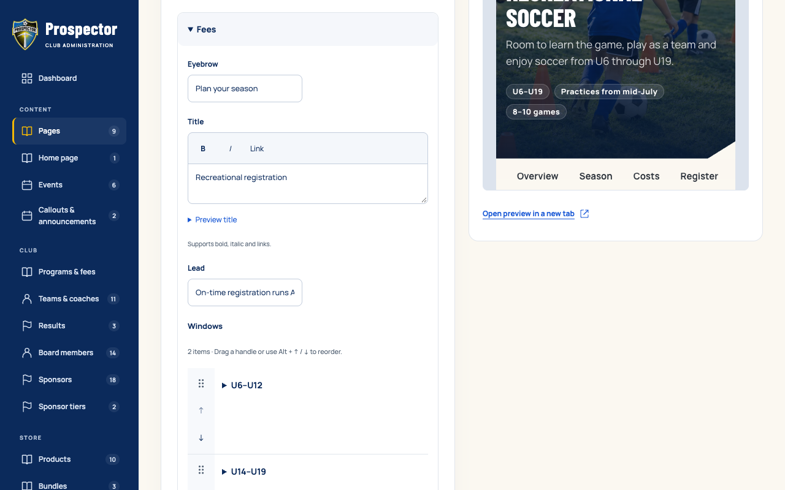
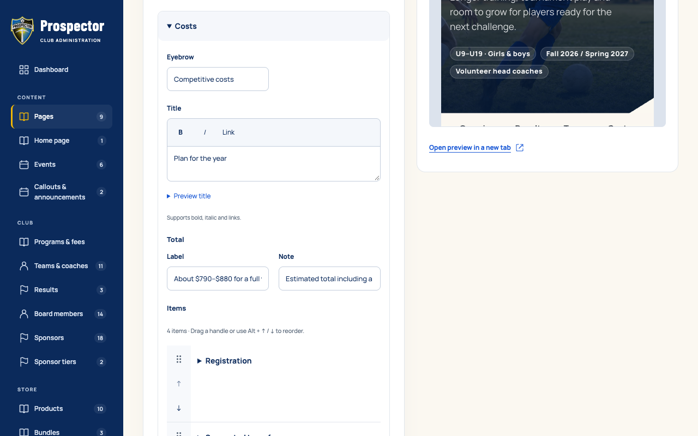

### Teams and coaches

**Teams & coaches**: each team needs **Age group**, **Gender** and **Level**, plus an optional **Name**, coaches and **Season**. The season defaults to the label in the Competitive page's Teams section, so update both when a new season starts. Use Display order for the public lineup.

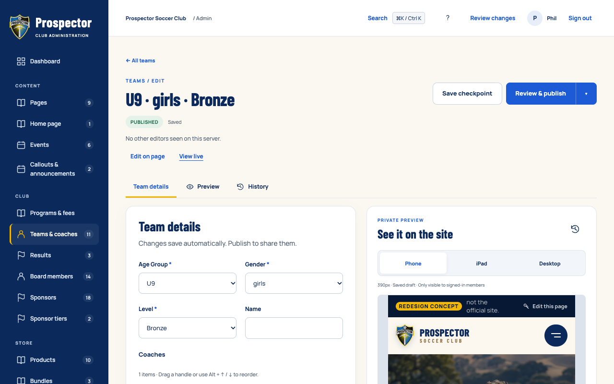

### Results

**Results**: enter **Competition**, **Team name** and **Place** (1 to 8), plus **Year**, **Age group**, **Gender** and a **Note** if useful.

A new result does not appear by itself. Open **Pages → Home → Results section** and/or **Pages → Competitive → Results section**, add it to the **Results** selection, and publish the result and the page together.

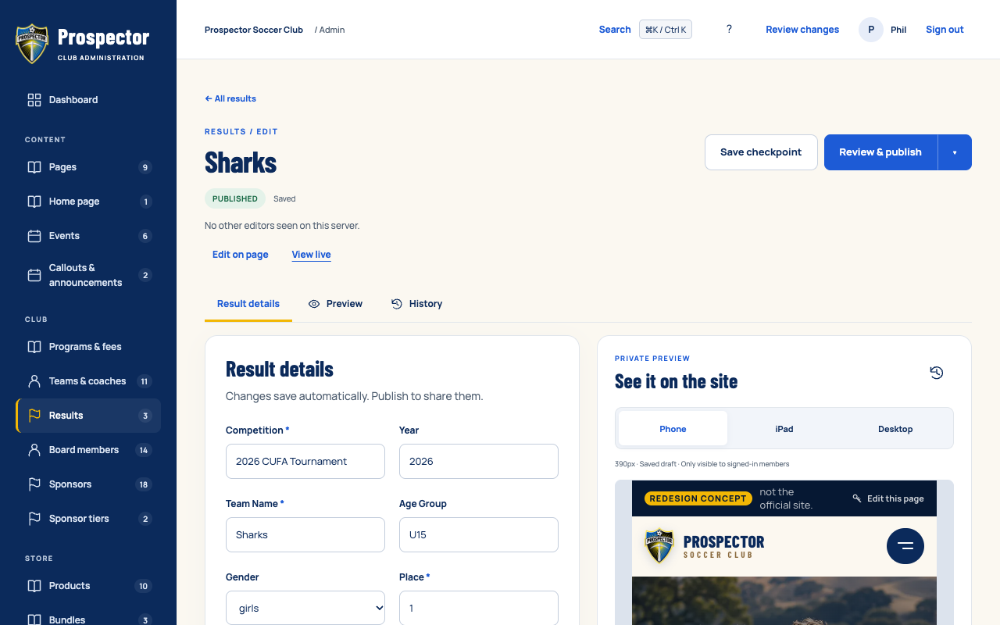

### Board members

**Board members**: one record per board position. **Role** and **Email** are required; add **Name**, a **Note**, and tick **Is President** or **Volunteer Link** where they apply. Leave **Name** empty for an open position and the **Vacant Label** text ("Open position") shows instead. Check that people agree to having their name and email published. Meeting information lives in **Pages → Board → Meetings**.

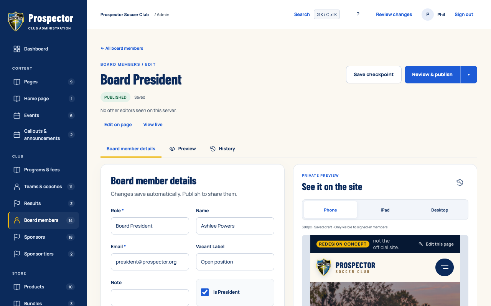

### Sponsors and sponsor tiers

Create the tier first in **Sponsor tiers** (**Name**, **Program**, **Price**, **Benefits**, **Featured**, **Show On Sponsors Page**). Then add each sponsor in **Sponsors** with **Name**, **Tier**, website **Url**, optional **Logo** and **Active**.

Publish the tier and sponsor together the first time. Headings and introductions for the sponsor sections are in **Pages → Home** and **Pages → Sponsors**. When adding a logo, check its alternative text and how it crops.

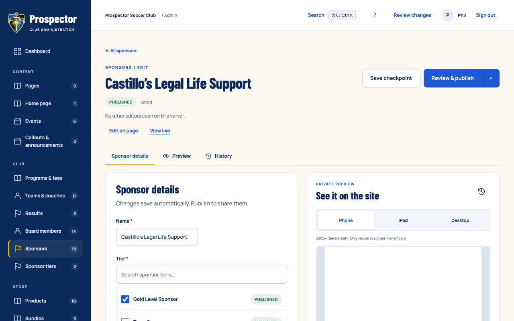
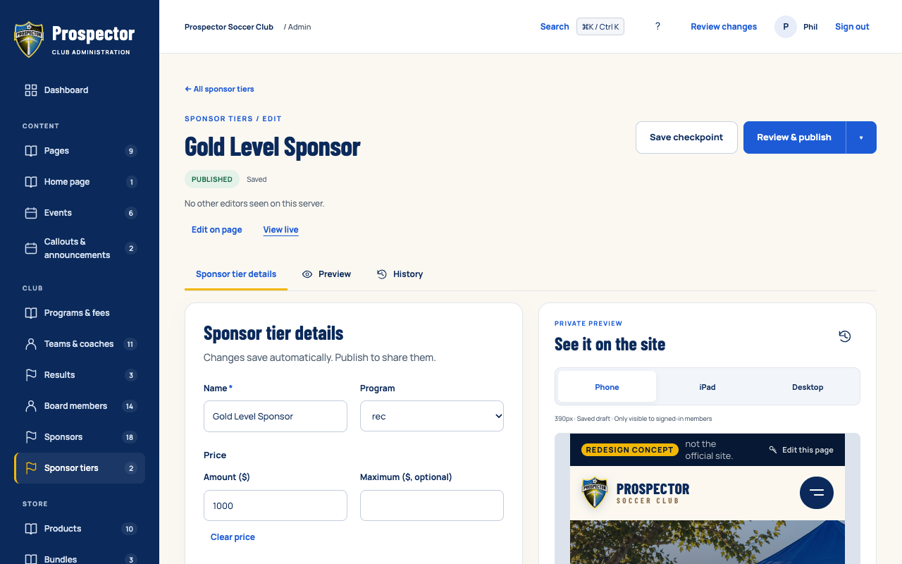

### Documents and forms

**Documents** is the library behind the Resources page. Fill in **Title**, **Description** and **Category** (club, safety, coaching, forms, policies). **Kind** (pdf, form, link) sets how it is presented. **Show In Library** controls whether it appears on Resources.

Under **Source**, set **Source type**:

- **url**: link to a file or online form hosted elsewhere. Enter the address in **Url**.
- **upload**: use a PDF from the media library. Choose **Document file**, then pick an existing PDF or upload one.

**External** opens the link in a new tab. Create or save, preview Resources, publish. To show the document on the Recreational, Competitive or Referees page as well, add it to that page's **Documents** field and publish the page. (The Documents list still shows an old line saying uploads are coming later; ignore it, uploads work.)

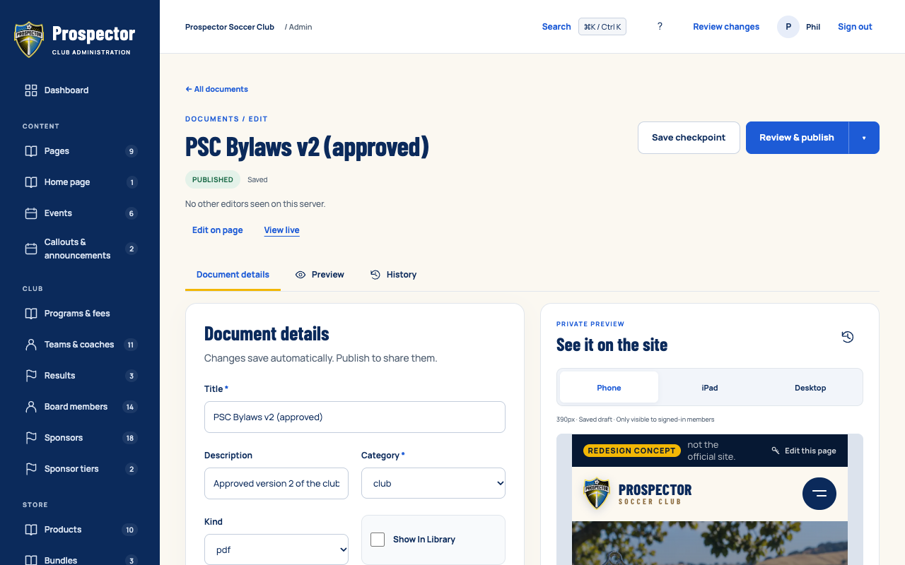

### FAQs

**FAQs**: choose the **Page**, write the **Question** and **Answer** (formatting allowed), save and publish. Only the Competitive page and the Shop page currently display FAQs. The other pages can be selected but will not show them; ask the website maintainer before relying on those.

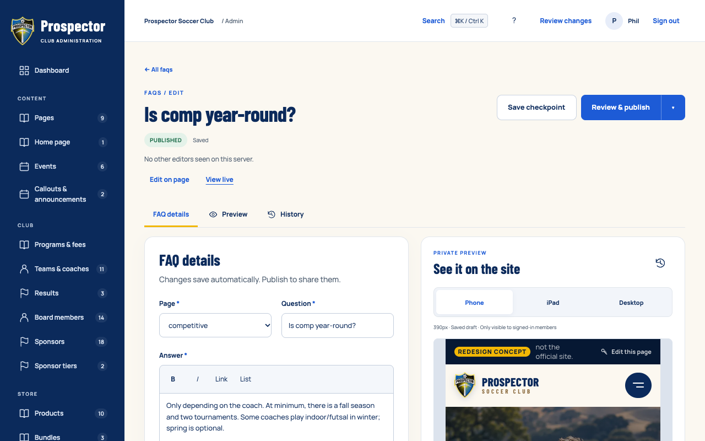

## Media library

### Upload and choose files

Open **Media** and drop files onto the upload area or choose **Choose files**. Images can be JPEG, PNG, WebP or GIF up to 8 MB; PDFs up to 15 MB. SVG is not accepted.

The site keeps your original and makes a web-optimised WebP copy no wider than 2000 pixels. Animated GIFs keep their animation in the original; the web copy is a still. Wait for each upload to finish. Uploading a file does not put it on a page: open the page or item and use **Choose image** / **Change image** (or **Choose document**) to pick it from the library.

Filter with **Search media**, **Media type**, **Unused** or **Missing alt text**. Open an item to see its details.

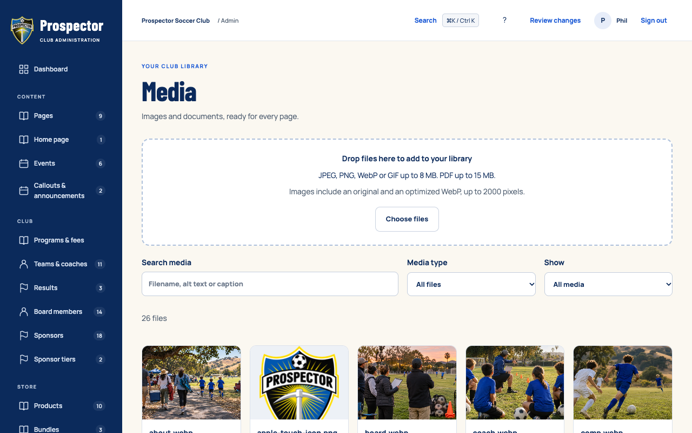
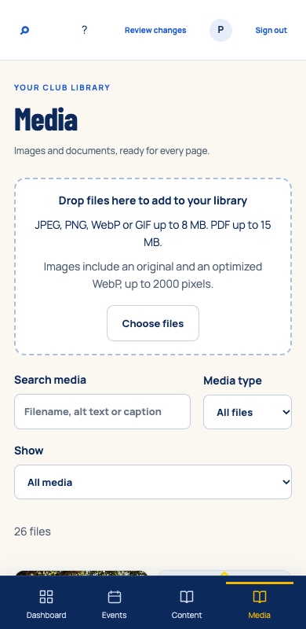

### Alternative text, captions and focal point

Alternative text describes an image to people who cannot see it. Say what matters in context ("Players shaking hands after the tournament final"), not the filename. Purely decorative images may have empty text on purpose.

**Default alternative text** is copied when you place the image somewhere new. Each placement then has its own **Alternative text for this use**, which you edit on the page or item. **Caption** is stored with the image and appears only where the design shows captions.

In Media details, make your changes and choose **Save media details**. Unlike ordinary content, media details have an explicit save button.

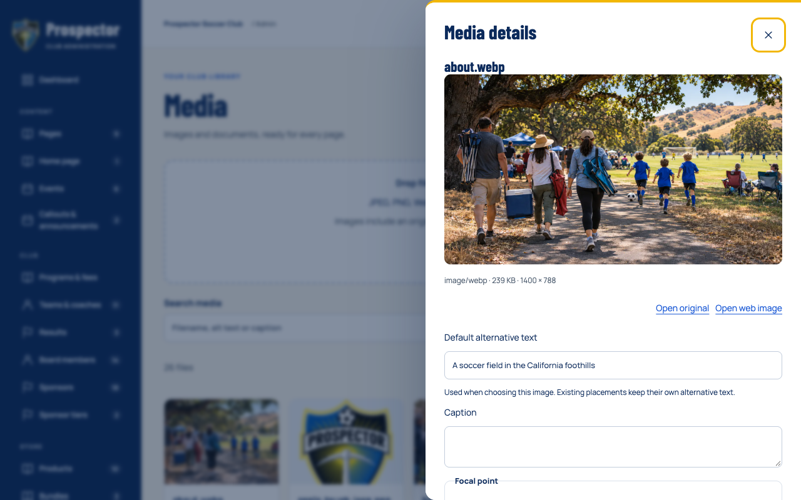

**Focal point** controls what stays visible when the design crops an image. Click the important part of the image or use the sliders, check the crop previews, save, then publish the media change. Different placements crop differently, so check the real page too.

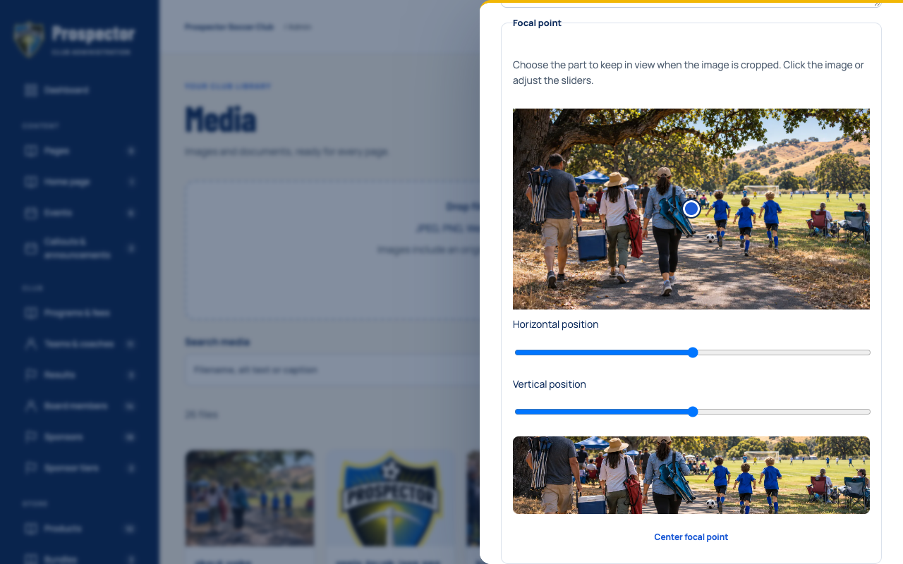

### Replace or delete

To swap a file everywhere it is used, open Media details, save any outstanding edits, choose **Replace file** and pick a file of the same kind. The item keeps its identity and placements. The replacement is a draft until you publish it; earlier published files stay available in history.

**Used by** lists every draft, published and scheduled use. **Delete media** (Editors and above) asks for confirmation and refuses while the file is in use; remove or replace those uses and publish first. Deleted items are not shown in the library again, so ask the website maintainer if something was deleted by mistake. For an image that is in use, use Replace rather than deleting and re-uploading.

Each person can upload about 256 MB per rolling 24 hours, counting failed and abandoned attempts. If you hit the limit, wait or ask the maintainer.

## Preview, publish and schedule

### Preview a draft

Open an item, wait for **Saved**, and use the **Preview** panel (on a phone, the Preview tab). It shows the real page with your saved draft, visible only to signed-in people. Switch between **Phone** (390px), **iPad** (820px) and **Desktop** (1280px); the preview may be scaled to fit. **Open preview in a new tab** gives more room; **Refresh preview** reloads it.

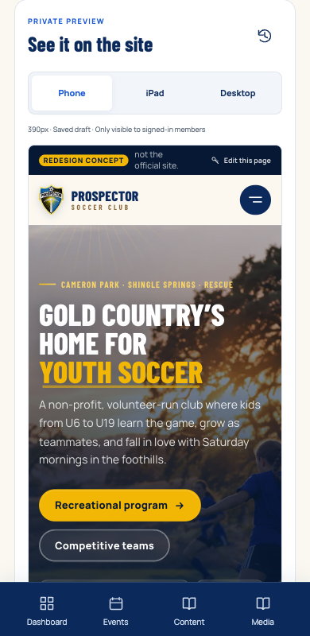

Preview shows saved drafts, following the same display rules as the live site: a result only appears if a page lists it, an inactive sponsor stays hidden, and a callout outside its display window is hidden even in preview.

### Publish now

1. Choose **Review & publish** in the editor, or **Review changes** in the top bar.
2. The list shows every saved change that is not yet live, including other people's and any media changes. Use **Select all** / **Deselect all** and tick only what you mean to publish.
3. Expand **Review details** on an item to see exactly what changed. A trashed item shows as **Remove from site**.
4. Leave **Action** on **Publish now**, add an optional **Publication note** (it appears in History), and choose **Publish N changes**.
5. Use **View live** in the confirmation to check the public page.

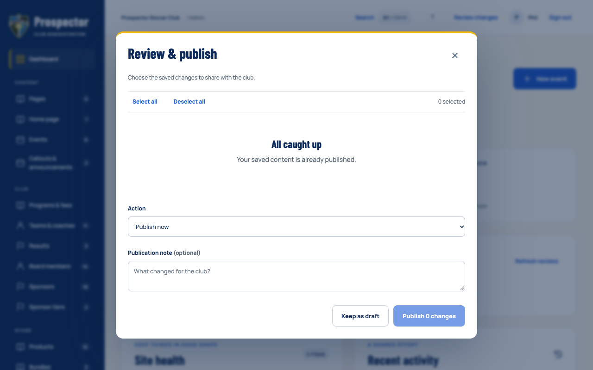

Who can do what here: Viewers can look at the differences, Contributors can request a review, and Editors, Admins and Owners can publish. **Keep as draft** closes the window without publishing anything.

After publishing, "Live now" means the public cache was refreshed immediately. If it says "Live within about 5 minutes", the site will catch up on its own; images can take about a minute longer. Use **View live** to check.

### Schedule for later

1. Open the arrow next to **Review & publish** and choose **Schedule for later**, or set **Action** to **Schedule for later** in the review window.
2. Tick the items, enter the **Publish date and time (Pacific)** and an optional note.
3. Choose **Schedule N changes**.

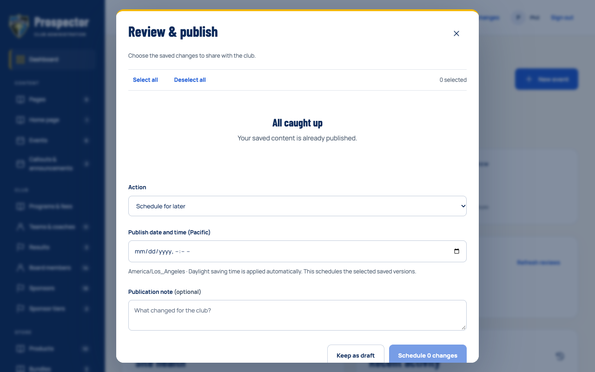

Scheduling freezes the version you selected. If you edit the item again afterwards, those edits are not included; cancel and reschedule to include them. Spring-forward times that do not exist are rejected.

To cancel, open the review window and choose **Cancel schedule** next to the item; it stays a draft. Publishing an item now replaces its schedule. Scheduled content appears on the public site at the chosen time; the daily housekeeping run records it in History a little later.

## Reviews

### Ask someone to check your work

Save your draft and choose **Request review** (Contributors see this instead of Review & publish; publishers find it under the arrow). Tick the items, write a **Review note** saying what to look at, and choose **Request review for N**. Media cannot be sent for review by itself; mention in the note which page uses your new image so the reviewer publishes both.

### Review someone else's work

Editors, Admins and Owners see requests under **Awaiting review** on the dashboard. Choose **Review [title]**, read the note, and compare **Live** with **Requested draft**. Open the item's preview if you want to see it in place.

**Approve and publish** makes that version live immediately. To send it back, write a **Return note** and choose **Return with note**; the draft is kept and the author sees your note. If the item changed while you were looking, the dialog asks you to reopen the latest version.

## History and undo

### Restore one item

1. Open the item and choose **History**.
2. Pick an entry to see who changed what and when. **Load earlier revisions** goes further back.
3. Choose **Restore this revision** and compare it with the current draft.
4. Choose **Restore draft** to bring it back as a draft you can preview and publish later. Publishers can instead tick **Publish restored revision immediately** and choose **Restore and publish**.

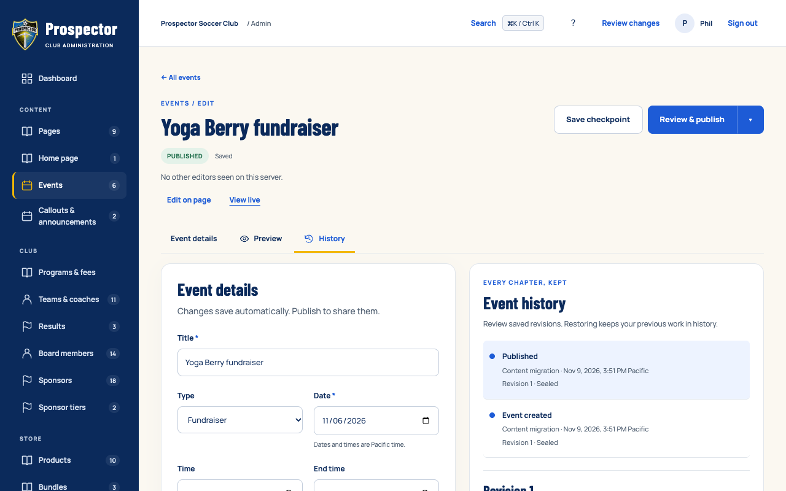
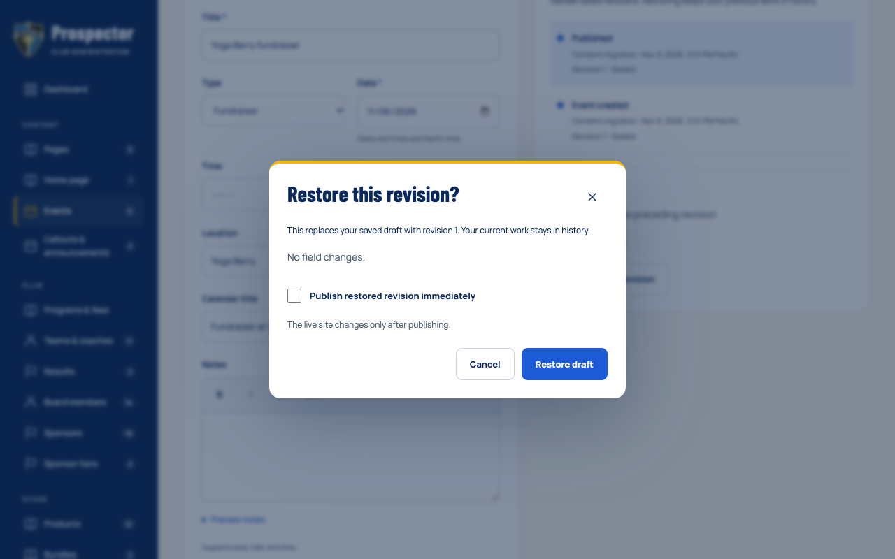

Restoring adds a new entry to History; nothing is lost. If the restore succeeds but the immediate publish fails, the restored draft is still saved: review it and publish separately. Media items cannot be restored this way; use **Replace file**.

### Compare and restore the whole site

**History → Site versions** lists every publication. **Compare with current** shows what would change in drafts, live content, ordering and schedules if you went back to that version. **All revisions** lists individual item changes with filters.

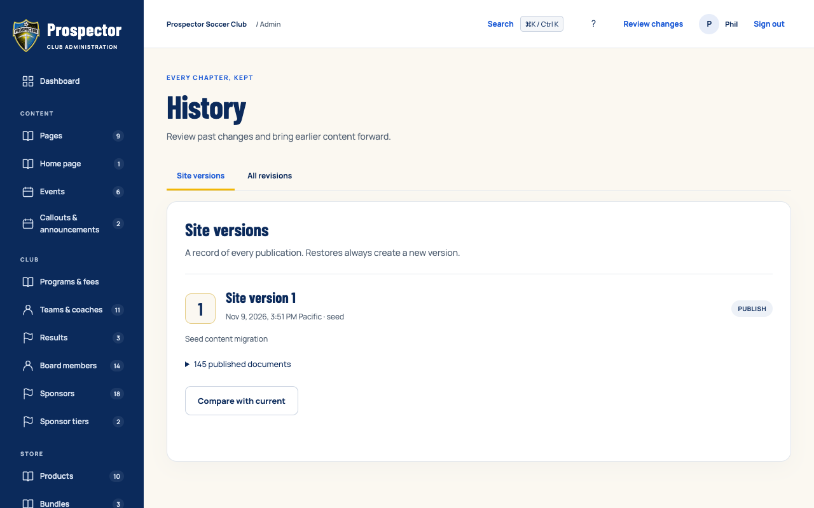
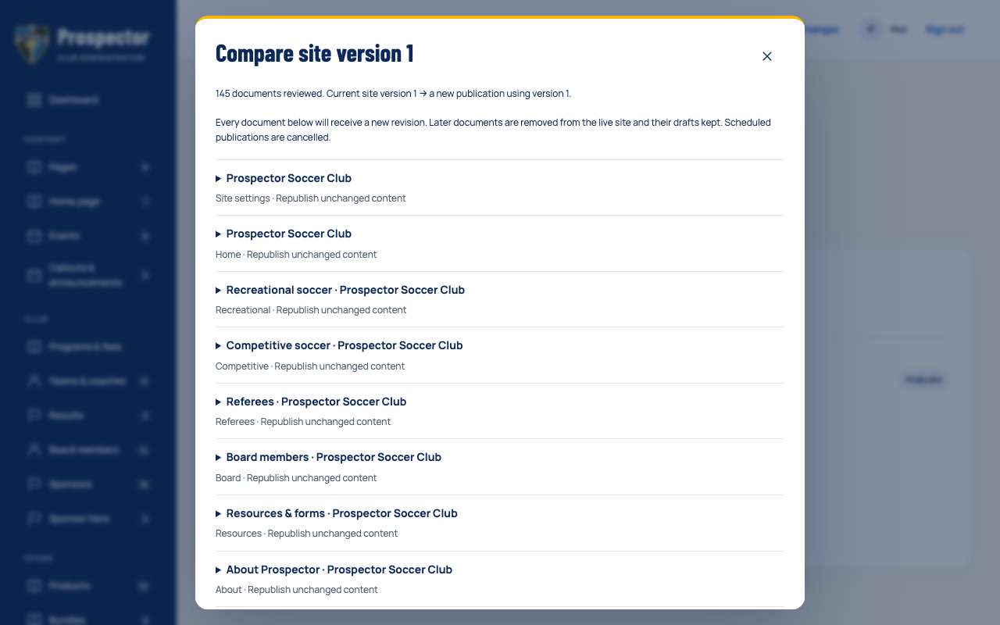

Only an Owner can choose **Restore site to this version**. Read the whole comparison, add a **Restore note** and choose **Confirm site restore**. It publishes a new version that matches the old one: listed items go back to their earlier content and order, schedules are cancelled, and items created later are removed from the live site (their drafts are kept). It does not change accounts, passwords or code. Ask others to stop editing while you do it; if someone saves in between, you must compare again.

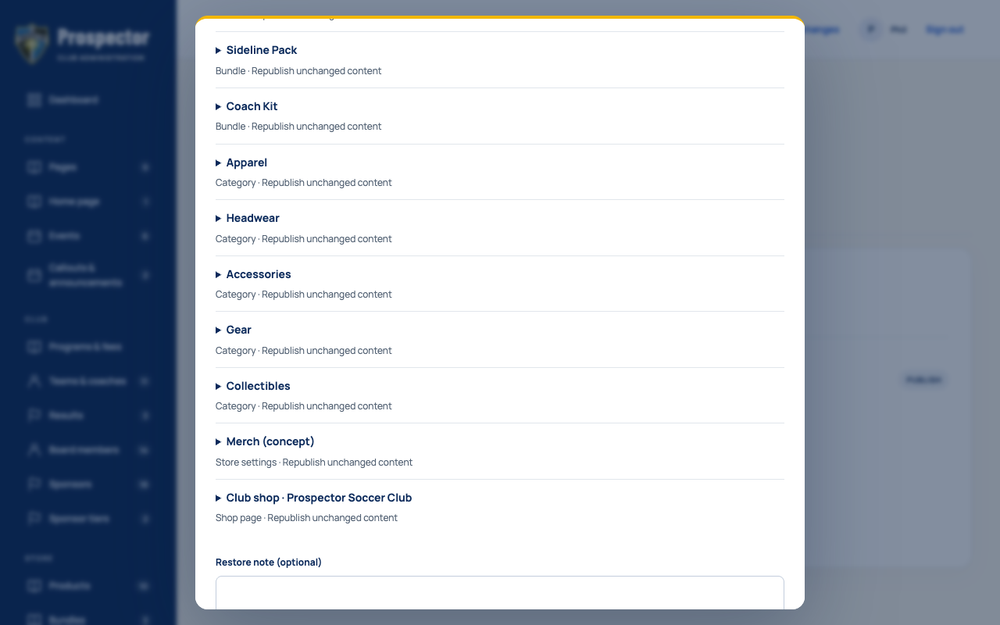

For a small mistake, restore the one item instead. Database and file recovery beyond this is the website maintainer's job (see HANDOFF).

## Audit log

Admins and Owners can open **Audit log** to see sign-ins, content changes, publications and account changes. Filter by **User**, **Action group**, **Exact action**, **Collection**, dates or text, then **Apply filters**. Dates cover whole Pacific days. Open a row for **Activity details**; **Load more** fetches older entries. **Export CSV** / **Export JSON** download everything matching the filters. Exports include usernames and IP addresses, so treat them as private.

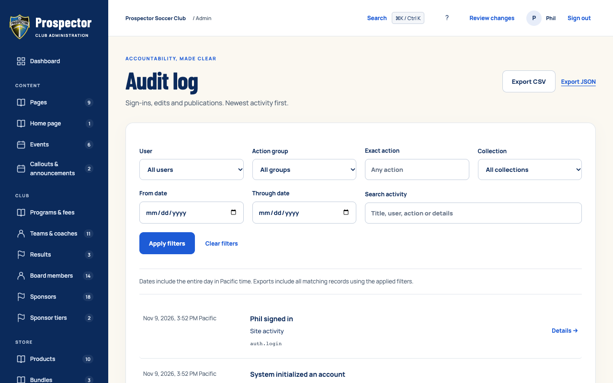

## People and roles

Everyone gets their own account. Give people the lowest role that covers their work.

| Role | Can |
| --- | --- |
| Viewer | Read content and history, see previews and the review window |
| Contributor | Viewer, plus create and edit drafts, request review, upload media and edit their own uploads |
| Editor | Contributor, plus publish, schedule, approve or return reviews, trash and restore, reorder, run link checks, edit or delete anyone's media, edit Site settings and Store settings |
| Admin | Editor, plus the audit log and exports, Rebuild snapshot, and managing Viewer, Contributor and Editor accounts |
| Owner | Admin, plus managing Admin and Owner accounts and restoring a whole site version |

Everyone manages their own profile, password and sessions. Nobody can change their own role or deactivate themselves, Admins cannot manage Admin or Owner accounts, and the last active Owner cannot be removed or demoted.

### Add someone

1. Open **Users → Add user**.
2. Enter **Display name**, **Username**, optional **Email** and **Role**.
3. Choose **Create user**.
4. Copy the temporary password shown and pass it on privately. It is shown once; choose **I have saved the password** when you have it.
5. Tell them to sign in and set their own password; the site insists on it before they can do anything else.

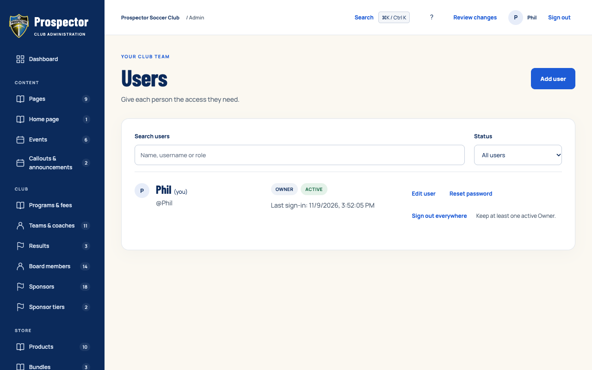
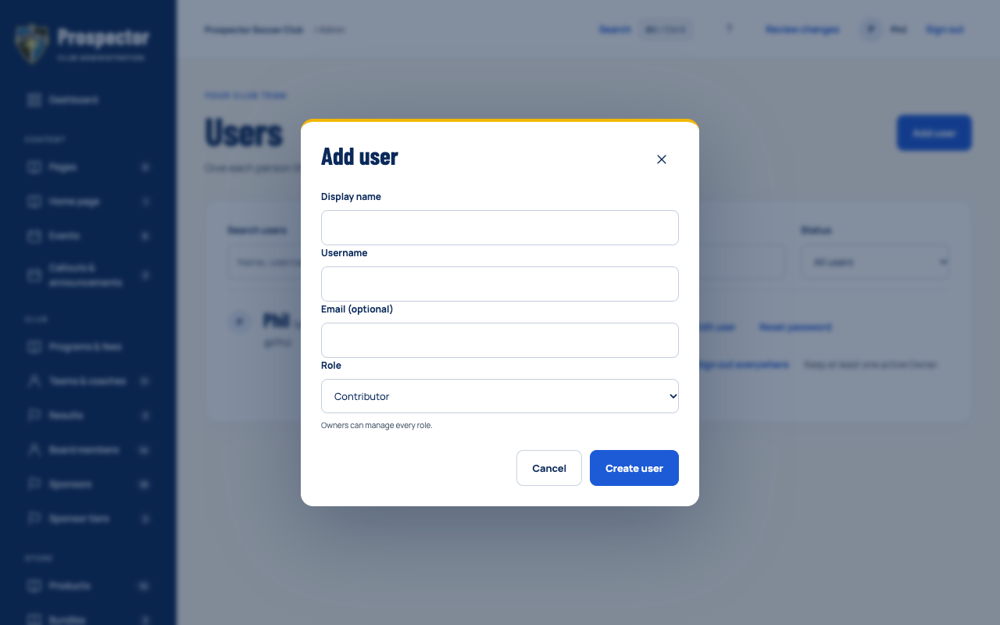

### Reset, deactivate or change access

- **Edit user** changes name, username, email or role (a role change signs them out).
- **Reset password** issues a new one-time temporary password and signs them out everywhere. They must set a new password at next sign-in.
- **Sign out everywhere** ends all their sessions without changing the password.
- **Deactivate** when someone leaves: they can no longer sign in, but their name stays on past changes. **Reactivate** restores access with their old password; reset it too if in doubt.

If you cannot manage a particular account, ask an Owner.

## Search and keyboard shortcuts

Choose **Search** in the top bar or press ⌘K (Mac) / Ctrl+K (Windows, Linux). Type a screen, command or item title, use the arrow keys and press Enter. Commands include navigation, new items, settings sections, **Review changes**, the iPad preview of the current editor and **Publish all**, which opens the review window with everything selected so you can check it before confirming.

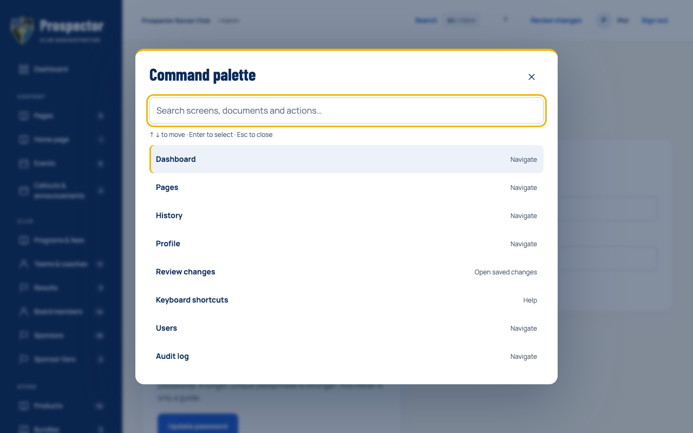

| Shortcut | What it does |
| --- | --- |
| ⌘/Ctrl + K | Search and commands |
| ⌘/Ctrl + S | Save a checkpoint in the current editor |
| ⌘/Ctrl + Shift + P | Review changes |
| `[` / `]` | Previous / next item in the collection (saves first) |
| `?` | Show shortcut help |
| Esc | Close a dialog or drawer, or cancel an in-place edit |
| Alt + Up/Down | Move a focused reorder handle |

Single-key shortcuts pause while you are typing in a field. After `[` or `]`, wait for the next item to appear before pressing again; very fast repeats can be ignored. Text undo (⌘/Ctrl+Z) works inside a field; for anything already saved, use History.

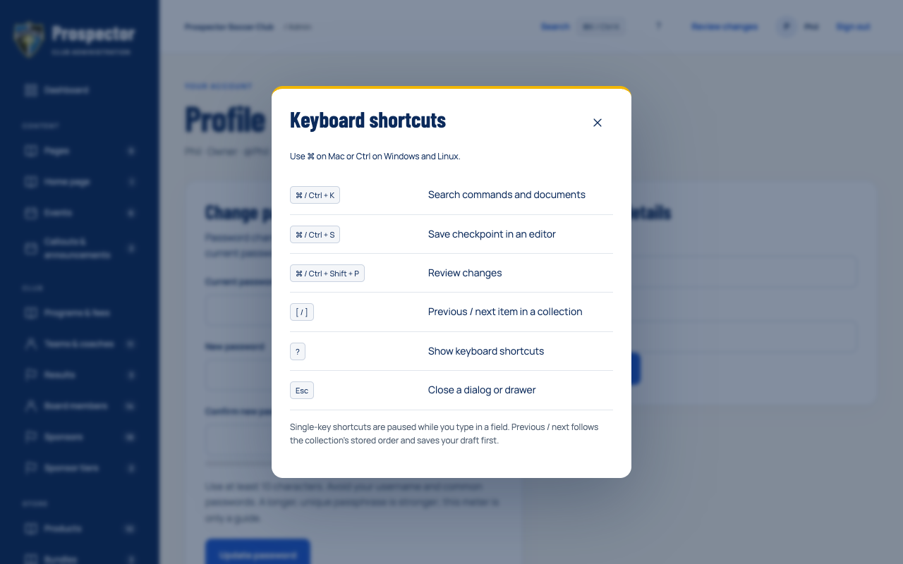

## Merchandise concept

The store shows what club merchandise could look like. With your normal content permissions you can edit **Products**, **Bundles**, **Categories**, **Store settings** (Editors and above) and **Pages → Shop page**.

- A product has a name, URL slug, category, description, images, prices and variants. **Generate variants** adds youth/adult/one-size and colour options; check the generated labels before publishing. Supplier notes are internal.
- A bundle groups existing products with quantities and an illustrative bundle price. Create the products first.
- Categories group products. The Shop page holds the introduction and featured content.
- Store settings control whether the store is shown and its wording. The payment, pickup, shipping, tax and notification fields describe possible future behaviour only.

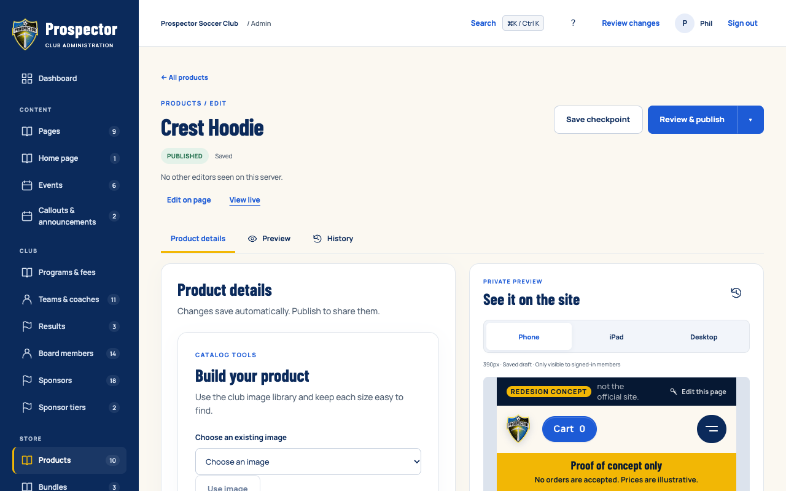
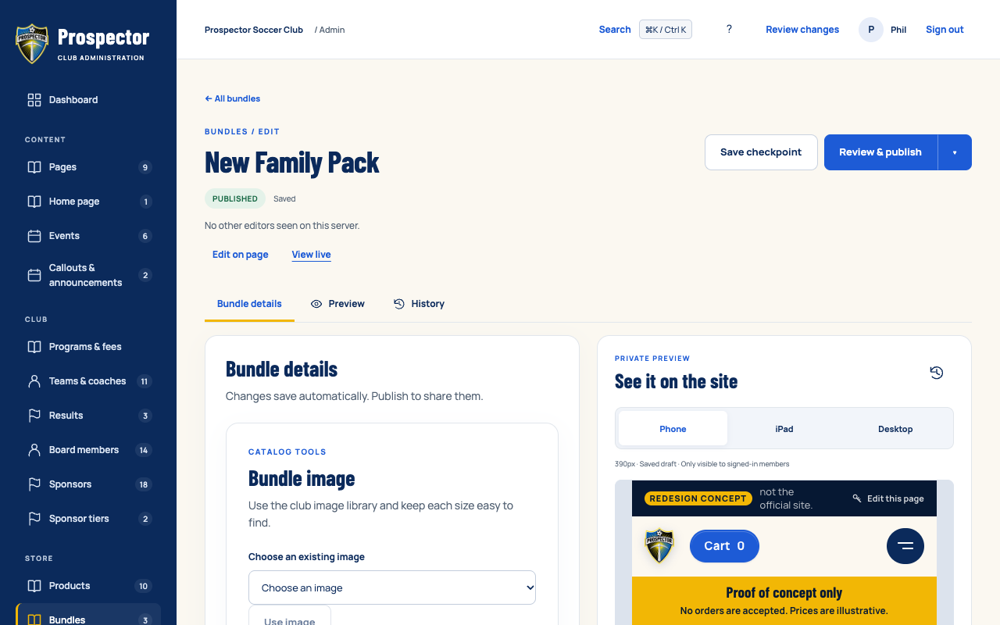
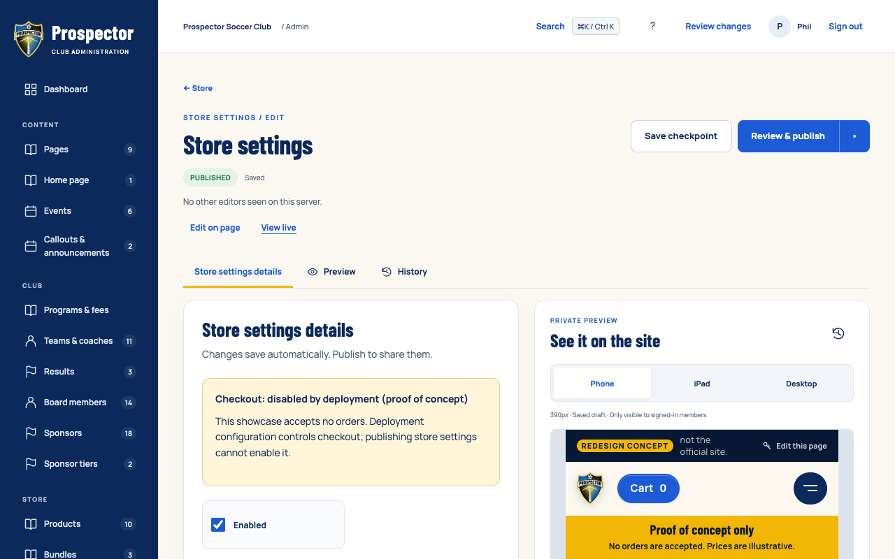

Visitors can browse, choose sizes and fill a cart. **They cannot order, pay, reserve stock or receive confirmations.** Checkout is switched off at the hosting level; publishing any store setting cannot turn it on. Keep the proof-of-concept notices and send real merchandise questions through the club's existing process.

## Troubleshooting

| What you see | What to do |
| --- | --- |
| Profile opens and asks for a new password | You have a temporary password. Choose a different new password and **Update password**. If you lost the temporary password, ask your administrator for another. |
| Sign-in rejected, or a wait timer | Check username and password. After five failures you must wait the time shown. Ask an Admin or Owner for a reset if needed. |
| I published but the public page has not changed | Check you published the right item and any page that refers to it. Wait up to five minutes (six for images) and use **View live**. Preview shows drafts, not the live site. |
| A new result, sponsor, FAQ or document is missing | Check the page it should appear on lists it, that **Active** or **Show In Library** is ticked, any dates or display window, and that the page actually displays that kind of content. |
| Red fields or a publication error | Follow the listed field links, fill the required fields, fix the broken references, then review again. |
| "Someone else saved this" | Read the comparison. **Discard mine** takes their version. **Keep mine (overwrite)** replaces their draft with yours as a new revision. Talk to them first. |
| The review list refreshed while I was publishing | Someone saved in the meantime. Look at the updated list, tick the items again and retry. |
| "Offline" or "Saving failed" | Keep the tab open, reconnect and retry. The editor can offer to recover the draft from this browser; do not clear browser data or switch devices before recovering it. |
| Preview looks old | Wait for **Saved**, choose **Refresh preview**, and check the item's display conditions. |
| Upload rejected | Check the file type and size and try again with a smaller valid file. If the upload ticket expired, choose the file again. The daily upload allowance may mean waiting. |
| Cannot delete an item or image | Look at **Used by**, remove or replace those references, publish, then retry. |
| A button I expect is missing | Your role does not allow it. Ask an Admin or Owner. |
| Someone else is editing but presence does not show them | Presence is approximate and can miss people. Coordinate directly; the site still prevents you from silently overwriting each other. |
| Site health shows a problem you cannot fix | Send the website maintainer the item title, the screen, the time and the exact message. Never include passwords. |
| The whole site needs to go back | Contact an Owner for a site-version restore. **Rebuild snapshot** is a repair tool that republishes what is already live; it is not an undo. |

## For the maintainer: recapturing the pictures

The screenshots in `docs/images/` are produced by `npm run docs:screenshots` from a local practice site. To refresh them:

1. In `.env` use `STORE_DRIVER=fs`, a dedicated `DATA_DIR` such as `.data-manual`, `PUBLIC_BASE_URL=http://localhost:3000`, `COOKIE_SECURE=false`, `SHOP_CHECKOUT=disabled`, and an `ADMIN_BOOTSTRAP_USERS` value with a local Owner whose password you generated with `npm run hash-password`. Keep real club or personal data out of the practice store.
2. Run `npm run build` then `npm run start` (the built server on port 3000; the hot-reload server redirects to 5173 and will not work).
3. In another terminal set `PSC_DOC_USER` and `PSC_DOC_PASSWORD` to that Owner account (environment or `.env`, never command arguments) and run `npm run docs:screenshots -- --list` to see the 41 files, then `npm run docs:screenshots`.

The script uses installed Google Chrome, signs in once, checks the account is an Owner with no pending password change, captures 38 desktop (1280×800) and three phone (390×800) views, opens confirmation dialogs without submitting them, and signs out. It creates, edits and publishes nothing, though sign-in and sign-out are recorded in the audit log. Do not run it while the e2e suite is using port 3000. Review the PNGs for private information before sharing.
